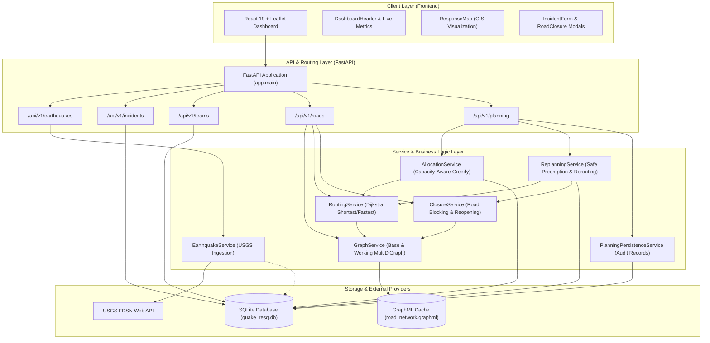

# QuakeResQ – Dynamic Earthquake Rescue Planning and Resource Allocation System

QuakeResQ is an intelligent, real-time disaster response decision-support system designed to optimize emergency rescue operations in the immediate aftermath of an earthquake. The system integrates real-time seismic event telemetry from the USGS, real-world OpenStreetMap road network topologies via OSMnx, Dijkstra-based shortest and fastest route optimization with NetworkX, dynamic multi-criteria incident triage, capacity-aware rescue team dispatch, and rule-based dynamic replanning under active road closures.

---

## Table of Contents

- [Problem Statement and Objectives](#problem-statement-and-objectives)
- [Key Features](#key-features)
- [System Architecture](#system-architecture)
- [Technology Stack](#technology-stack)
- [Folder Structure](#folder-structure)
- [Installation and Setup (Windows PowerShell)](#installation-and-setup-windows-powershell)
- [Running the Application](#running-the-application)
- [API Endpoint Documentation](#api-endpoint-documentation)
- [Testing and Verification](#testing-and-verification)
- [Dashboard & UI Overview](#dashboard--ui-overview)
- [Limitations and Future Enhancements](#limitations-and-future-enhancements)

---

## Problem Statement and Objectives

### Problem Statement
In post-earthquake disaster scenarios, emergency dispatchers and incident commanders face extreme uncertainty:
1. **Critical Infrastructure Damage**: Collapsed overpasses, debris, and structural hazards sever major road corridors, rendering static routes impassable.
2. **Resource Scarcity**: Emergency medical services (EMS), Urban Search and Rescue (USAR), and heavy excavation equipment are finite and cannot respond to all calls simultaneously.
3. **Dynamic Priority Influx**: New high-priority emergencies (e.g., collapsed hospitals or schools) arrive continuously while units are already deployed to minor incidents.
4. **Information Latency**: Manual coordination and non-spatial dispatch lead to delayed response times, duplicated dispatches, and stranded rescue teams.

### System Objectives
* **Automate Incident Prioritization**: Calculate deterministic, multi-criteria priority scores (0–100 scale) for reported casualties and infrastructure damage.
* **Model Real-World Road Topologies**: Ingest directed road graphs with authentic speed limits, lengths, and one-way restrictions for Central Bengaluru.
* **Optimize Shortest & Fastest Routing**: Compute optimal travel times and distance-based paths using Dijkstra algorithms, accounting for physical departure constraints.
* **Capacity-Aware Greedy Dispatch**: Match highest-priority incidents to the best-suited rescue units minimizing response time without exceeding team capacity.
* **Dynamic Replanning & Safe Preemption**: Dynamically reassign units to critical life-threatening calls with strict mathematical justification ($\Delta \text{score} \ge 10.0$) while protecting in-progress field operations.
* **Road Closure Adaptation**: Detect routes severed by physical road closures, cancel severed assignments, recalculate active detours, and update situational awareness across an interactive GIS dashboard.

---

## Key Features

### 1. USGS Earthquake Integration
* Ingests real-time seismic event telemetry from the USGS Earthquake Hazards Program GeoJSON feed.
* Filters events by lookback window (hours), bounding box coordinates, minimum magnitude, and event counts.
* Standardizes geographic coordinates into RFC 7946 GeoJSON `[longitude, latitude, depth_km]`.
* Provides optional database synchronization to persist seismic events into local SQLite storage.

### 2. OSMnx & OpenStreetMap Road Network
* Downloads and models the Central Bengaluru road network (Center: `12.9716°N, 77.5946°E`, Radius: 2500m) as a directed `MultiDiGraph`.
* Enriches graph edges with real road attributes: `length` (meters), `speed_kph`, and calculated `travel_time` (seconds).
* Serializes the road topology into an offline GraphML cache (`backend/data/graph_cache/road_network.graphml`) for rapid, dependency-free application startup.
* Separates the immutable base graph from a mutable working graph to support real-time closures without corrupting baseline geometry.

### 3. NetworkX Dijkstra Routing Engine
* Computes optimal traversal paths using Dijkstra's algorithm weighted by either `travel_time` (fastest) or `length` (shortest).
* **Routable Departure Snapping**: Implements `find_nearest_departure_node()` to ensure departure points snap to nodes with `out_degree > 0`, avoiding dead ends and terminal highway off-ramps.
* **Routable Arrival Snapping**: Implements `find_nearest_arrival_node()` ensuring incident endpoints have `in_degree > 0`.
* Translates internal graph paths into GeoJSON `LineString` coordinates for direct frontend map rendering.

### 4. Multi-Criteria Incident Priority Ranking
Calculates priority scores using weighted multi-criteria decision analysis:

$$\text{Priority Score} = \left(0.5 \times \text{Severity} + 0.3 \times \text{Urgency} + 0.2 \times \text{Evidence}\right) \times 20$$

* Inputs evaluated on a 1–5 scale, resulting in a normalized 0–100 continuous score.
* Categorizes incidents into deterministic operational triage tiers:
  * **Critical**: $\text{Score} \ge 80.0$
  * **High**: $60.0 \le \text{Score} < 80.0$
  * **Medium**: $40.0 \le \text{Score} < 60.0$
  * **Low**: $\text{Score} < 40.0$

### 5. Capacity-Aware Rescue Team Allocation
* Respects multi-mission capacity per team (e.g., USAR units handling up to 3 concurrent tasks).
* Computes remaining capacity dynamically by auditing active assignments in SQLite:
  $$\text{Remaining Capacity} = \text{Team Capacity} - \text{Active Assignments}$$
* Prioritizes unassigned incidents in descending order of priority score.
* Evaluates all eligible candidate teams using Dijkstra routing metrics and assigns the team with the lowest travel time.

### 6. Dynamic Replanning & Safe Preemption
* **Protected Operations**: Rescue missions with status `in_progress` or `completed` are **strictly protected** and can never be preempted.
* **Justified Preemption**: A team on a `pending` or `assigned` mission can be preempted for a newly reported emergency if and only if:
  1. The new incident has a higher priority score by at least $10.0$ points ($\text{Score}_{\text{new}} - \text{Score}_{\text{current}} \ge 10.0$).
  2. The team has a physically verified, open route to the new incident on the current working graph.
* **State Reconciliation**: Preempted assignments are transitioned to status `reassigned`, and the displaced incident returns to `reported` status.
* **Audit Persistence**: Every replanning action records full preemption justifications and rerouting details inside atomic `PlanningRun` records.

### 7. Road Closure & Dynamic Rerouting
* Allows incident commanders to temporarily close directed road segments by `start_node_id`, `end_node_id`, and `edge_id`.
* Supports closing single-direction links or both directions simultaneously.
* Evaluates all active field routes against the updated working graph:
  * **Detour Available**: Reroutes the team along the new shortest clear path.
  * **Route Severed**: If no alternative path exists, safely marks the assignment as `cancelled` and returns the incident to `reported` for re-dispatch.
* Supports reopening road segments, restoring base graph attributes, and re-enabling blocked corridors.

### 8. Interactive React Leaflet Dashboard
* Real-time spatial map centered on Bengaluru (`12.9716, 77.5946`).
* Color-coded incident markers reflecting triage severity (Red = Critical, Orange = High, Yellow = Medium, Green = Low).
* Rescue team markers with real-time status indicators (Available = Green, Assigned = Blue).
* Visual representation of active road closures and interactive route polylines.
* Responsive incident reporting modal, road closure management modal, and one-click dynamic replanning trigger.

---

## System Architecture



---

## Technology Stack

### Backend
| Component | Technology | Version | Purpose |
| :--- | :--- | :--- | :--- |
| **Framework** | FastAPI | `^0.115` | High-performance asynchronous REST API framework |
| **Server** | Uvicorn | `^0.34` | ASGI server implementation |
| **ORM & DB** | SQLAlchemy | `^2.0` | Relational database mapping with SQLite backend |
| **Data Validation** | Pydantic | `^2.10` | Schema validation and serialization |
| **Graph Modeling** | NetworkX | `^3.0` | Graph representation and Dijkstra shortest path routing |
| **Geospatial & Road**| OSMnx | `^2.0` | OpenStreetMap road network extraction and GraphML caching |
| **Testing** | Pytest | `^8.0` | Unit, integration, and regression test runner |

### Frontend
| Component | Technology | Version | Purpose |
| :--- | :--- | :--- | :--- |
| **Core Library** | React | `^19.1` | Declarative user interface library |
| **Build Tool** | Vite | `^7.1` | Next-generation frontend tooling and bundler |
| **Mapping Engine** | Leaflet & React Leaflet | `^1.9` / `^5.0` | Interactive geospatial map visualization |
| **Styling** | Modern CSS / CSS Variables | Custom | Responsive, dark-mode inspired disaster dashboard styling |

---

## Folder Structure

```text
QuakeResQ/
├── backend/
│   ├── app/
│   │   ├── models/                    # SQLAlchemy ORM database models
│   │   │   ├── assignment.py          # Rescue team mission assignments
│   │   │   ├── earthquake.py          # USGS seismic telemetry records
│   │   │   ├── incident.py            # Disaster casualties and infrastructure damage
│   │   │   ├── planning_run.py        # Planning and replanning execution audits
│   │   │   ├── rescue_team.py         # Response units and capacity attributes
│   │   │   └── road_closure.py        # Directed road network edge closures
│   │   ├── routes/                    # FastAPI route handlers
│   │   │   ├── earthquakes.py         # USGS event querying and syncing
│   │   │   ├── health.py              # Health check probes
│   │   │   ├── incidents.py           # Incident CRUD & priority ranking
│   │   │   ├── planning.py            # Resource allocation & dynamic replanning
│   │   │   ├── roads.py               # Road graph status, routing, & closures
│   │   │   └── teams.py               # Rescue team management
│   │   ├── schemas/                   # Pydantic request/response schemas
│   │   │   ├── api_models.py          # GeoJSON, route, and closure schemas
│   │   │   └── entities.py            # Incident, team, and allocation schemas
│   │   ├── scripts/                   # One-time operational scripts
│   │   │   └── load_bengaluru_graph.py # Bengaluru road network download & cache script
│   │   ├── services/                  # Business logic and domain algorithms
│   │   │   ├── allocation_service.py  # Capacity-aware greedy team dispatch
│   │   │   ├── closure_service.py     # Road segment closure & reopening management
│   │   │   ├── earthquake_service.py  # USGS HTTP ingestion and coordinate normalization
│   │   │   ├── graph_service.py       # MultiDiGraph cache management & departure snapping
│   │   │   ├── planning_persistence.py# Atomic database persistence of planning runs
│   │   │   ├── replanning_service.py  # Rule-based safe preemption & rerouting
│   │   │   └── routing_service.py     # Dijkstra shortest/fastest route calculator
│   │   ├── database.py                # Database connection, engine, and session makers
│   │   ├── dependencies.py            # FastAPI dependency injection singletons
│   │   ├── migrations.py              # Idempotent database column migrations
│   │   └── main.py                    # Application lifecycle and router registration
│   ├── data/
│   │   └── graph_cache/               # Cached road network GraphML files
│   │       └── road_network.graphml   # Serialized Bengaluru Central road graph (6.8 MB)
│   ├── tests/                         # Automated pytest test suites (241 tests)
│   ├── quake_resq.db                  # SQLite database file
│   └── requirements.txt               # Backend Python dependencies
├── frontend/
│   ├── src/
│   │   ├── components/                # Modular React dashboard components
│   │   │   ├── DashboardHeader.jsx    # System title and connection status badge
│   │   │   ├── IncidentDetailsModal.jsx # Detailed view of incident attributes
│   │   │   ├── IncidentFormModal.jsx  # Form for reporting new emergency incidents
│   │   │   ├── MetricsOverview.jsx    # Live metrics cards (incidents, teams, closures)
│   │   │   ├── ResponseMap.jsx        # Interactive Leaflet map with GIS layers
│   │   │   └── RoadClosureModal.jsx   # Form for simulating road closures
│   │   ├── data/                      # Client-side configuration and defaults
│   │   ├── pages/
│   │   │   └── Dashboard.jsx          # Primary incident command dashboard page
│   │   ├── services/
│   │   │   └── api.js                 # API client for backend communication
│   │   ├── App.jsx                    # Root React component
│   │   ├── main.jsx                   # React entry point
│   │   └── styles.css                 # Custom disaster management UI styling
│   ├── index.html                     # HTML page template
│   ├── package.json                   # Node.js dependencies and scripts
│   └── vite.config.js                 # Vite bundler configuration
├── .gitignore                         # Git ignore definitions
└── README.md                          # Project documentation
```

---

## Installation and Setup (Windows PowerShell)

### Prerequisites
* **Python**: Version `3.10` or newer (Python `3.14` supported).
* **Node.js**: Version `20.19` or newer with `npm`.
* **Git**: Installed and available in PowerShell.

### 1. Clone & Navigate to Repository
```powershell
Set-Location "c:\Users\Cloud Nine\OneDrive\Documents\Nandini\Projects\QuakeResQ\QuakeResQ"
```

### 2. Backend Setup
1. Create and activate a Python virtual environment:
   ```powershell
   python -m venv .venv
   .\.venv\Scripts\Activate.ps1
   ```
2. Install the backend dependencies:
   ```powershell
   python -m pip install --upgrade pip
   python -m pip install -r backend\requirements.txt
   ```
3. Set `PYTHONPATH` to include the backend directory:
   ```powershell
   $env:PYTHONPATH = "backend"
   ```

### 3. One-Time Road Graph Cache Setup
The project includes a pre-cached GraphML file for Central Bengaluru (`backend/data/graph_cache/road_network.graphml`). If you need to re-generate or refresh the cache:
```powershell
python backend\app\scripts\load_bengaluru_graph.py
```
*Downloads the OSMnx road network within a 2500m radius of Central Bengaluru (`12.9716, 77.5946`) and caches it.*

### 4. Frontend Setup
1. Navigate to the frontend directory:
   ```powershell
   Set-Location frontend
   ```
2. Install npm packages:
   ```powershell
   npm install
   ```
3. Return to repository root:
   ```powershell
   Set-Location ..
   ```

---

## Running the Application

### 1. Start the FastAPI Backend
In your first PowerShell terminal (with virtual environment activated):
```powershell
Set-Location QuakeResQ
$env:PYTHONPATH = "backend"
.\.venv\Scripts\python.exe -m uvicorn app.main:app --host 127.0.0.1 --port 8000 --reload
```
* **API Server**: `http://127.0.0.1:8000`
* **Swagger API Documentation**: `http://127.0.0.1:8000/docs`
* **ReDoc Documentation**: `http://127.0.0.1:8000/redoc`

### 2. Start the React Frontend
In a second PowerShell terminal:
```powershell
Set-Location QuakeResQ\frontend
npm run dev
```
* **Interactive Dashboard**: `http://localhost:5173`

---

## API Endpoint Documentation

### System Health & Status
| Method | Endpoint | Description |
| :--- | :--- | :--- |
| `GET` | `/health` | Application root health check |
| `GET` | `/api/v1/health` | Versioned v1 health check |

### Earthquakes (USGS Telemetry)
| Method | Endpoint | Query Parameters | Description |
| :--- | :--- | :--- | :--- |
| `GET` | `/api/v1/earthquakes/events` | `min_magnitude`, `limit`, `hours`, `sync_db` | Fetches real-time seismic events as GeoJSON FeatureCollection |

### Incidents Management & Triage
| Method | Endpoint | Request Body | Description |
| :--- | :--- | :--- | :--- |
| `POST` | `/api/v1/incidents` | `IncidentRequest` JSON | Create a new earthquake incident |
| `GET` | `/api/v1/incidents` | None | List all recorded incidents |
| `GET` | `/api/v1/incidents/rankings` | None | List incidents sorted by priority score descending |
| `GET` | `/api/v1/incidents/{id}` | None | Retrieve single incident by ID |
| `PUT` | `/api/v1/incidents/{id}` | `IncidentRequest` JSON | Update incident details and recalculate priority |
| `POST`| `/api/v1/incidents/{id}/calculate-priority` | None | Recalculate priority score from severity/urgency/evidence |

### Rescue Teams Management
| Method | Endpoint | Request Body | Description |
| :--- | :--- | :--- | :--- |
| `POST` | `/api/v1/teams` | `RescueTeamRequest` JSON | Register a new rescue team |
| `GET` | `/api/v1/teams` | None | List all rescue teams and capacities |
| `GET` | `/api/v1/teams/{id}` | None | Retrieve single rescue team by ID |
| `PUT` | `/api/v1/teams/{id}` | `RescueTeamRequest` JSON | Update team status, coordinates, or capacity |

### Road Network, Closures & Dijkstra Routing
| Method | Endpoint | Request Body | Description |
| :--- | :--- | :--- | :--- |
| `GET` | `/api/v1/roads/graph` | None | Retrieve road graph status, node count, edge count, and active version |
| `POST` | `/api/v1/roads/route` | `RouteRequest` JSON | Calculate shortest/fastest route between coordinates |
| `GET` | `/api/v1/roads/closures` | `status` (`active`/`cleared`/`all`) | List active and historical road closures |
| `POST` | `/api/v1/roads/closures` | `RoadClosureCreateRequest` JSON | Close road segment(s) in working graph and record in SQLite |
| `POST` | `/api/v1/roads/reopen` | `RoadReopenRequest` JSON | Reopen closed road segment(s) and restore edge attributes |

### Planning & Dynamic Replanning
| Method | Endpoint | Query Parameters | Description |
| :--- | :--- | :--- | :--- |
| `POST` | `/api/v1/planning/allocate` | None | Execute initial capacity-aware greedy resource allocation |
| `POST` | `/api/v1/planning/replan` | `allow_preemption=true` | Execute dynamic replanning with safe preemption and closure rerouting |
| `POST` | `/api/v1/planning/evaluate-closures` | None | Audit active routes against working graph and detect severed segments |

---

## Testing and Verification

QuakeResQ features a comprehensive automated testing suite encompassing unit tests, service logic, graph algorithms, and API contract validations.

### Test Execution Command
```powershell
Set-Location QuakeResQ
$env:PYTHONPATH = "backend"
.\.venv\Scripts\python.exe -m pytest backend/tests/ -v
```

### Test Suite Results: **241 Passed, 0 Failed**
All 241 automated tests pass with 100% success rate across 17 test modules:

| Test Module | Test Focus | Count | Status |
| :--- | :--- | :---: | :---: |
| `test_replanning_service.py` | Safe preemption, delta threshold, in-progress guards, severed closures | 5 | **PASSED** |
| `test_allocation_service.py` | Multi-mission capacity tracking, workload audit, departure snapping | 6 | **PASSED** |
| `test_allocation_api.py` | Allocation API contracts, rollback safety, capacity enforcement | 8 | **PASSED** |
| `test_planning_persistence.py`| SQLite audit records, planning history, assignment lifecycle | 8 | **PASSED** |
| `test_migrations.py` | Idempotent database schema upgrades without data loss | 4 | **PASSED** |
| `test_load_bengaluru_graph.py` | Coordinate-based road graph extraction and GraphML serialization | 3 | **PASSED** |
| `test_routing_service.py` | Dijkstra shortest/fastest routes, turn restrictions, coordinate snapping | 37 | **PASSED** |
| `test_closure_service.py` | Working graph edge deletion, bi-directional closing, reopening | 32 | **PASSED** |
| `test_graph_service.py` | GraphML parsing, OSMnx KDTree indexing, Haversine fallback | 38 | **PASSED** |
| `test_earthquake_service.py` | USGS real-time feeds, bounding box filters, GeoJSON formatting | 30 | **PASSED** |
| `test_incidents_api.py` | Multi-criteria priority formulas, input validation, incident CRUD | 28 | **PASSED** |
| `test_teams_api.py` | Rescue team CRUD, capacity bounds, status transitions | 15 | **PASSED** |
| `test_api_v1_endpoints.py` | End-to-end endpoint integration, HTTP status codes, error handling | 14 | **PASSED** |
| `test_schemas.py` | Pydantic entity validation and schema constraints | 4 | **PASSED** |
| `test_api_schemas.py` | API request/response model validation | 4 | **PASSED** |
| `test_dependencies.py` | Dependency injection wiring and singletons | 3 | **PASSED** |
| `test_health.py` | System health probe verification | 2 | **PASSED** |
| **Total** | | **241** | **100% PASS** |

### Frontend Build Verification
The frontend compiles cleanly for production with Vite:
```powershell
Set-Location QuakeResQ\frontend
npm run build
```
*Output: `✓ built in 2.80s` (Zero compilation errors, zero lint warnings).*

---

## Dashboard & UI Overview

### 1. Incident Command Center
* **Live GIS Map**: Displays Bengaluru Central with interactive OSM basemaps.
* **Incident Markers**: Color-coded markers indicating priority level (Critical: Red, High: Orange, Medium: Yellow, Low: Green). Clicking an incident displays its title, casualty count, priority score, and assigned rescue team.
* **Rescue Team Units**: Visualized with specialized icons indicating availability, current mission status, and remaining capacity.
* **Active Closures**: Flagged with road closure hazard indicators along blocked graph segments.
* **Route Polylines**: Visualizes computed Dijkstra paths connecting deployed teams to their target emergency sites.

### 2. Operational Modals
* **Report Incident Modal**: Allows emergency operators to log new incident locations, severity (1–5), urgency (1–5), people affected, and evidence strength with real-time priority score preview.
* **Road Closure Simulation Modal**: Enables commanders to select start and destination node pairs, choose one-way or two-way closures, provide obstruction reasons (e.g., "Bridge Collapse"), and apply closures instantly.
* **Dynamic Replanning Action**: Trigger button executing `POST /api/v1/planning/replan`, displaying instant notifications of preempted assignments, rerouted paths, or cancelled severed routes.

---

## Limitations and Future Enhancements

### Current Limitations
1. **Demonstration Graph Boundary**: The road network is currently bounded to a 2500m radius around Central Bengaluru (`12.9716, 77.5946`). Incidents occurring outside this polygon snap to boundary perimeter nodes.
2. **Single-Mode Travel**: Routing currently models vehicle drive networks (`network_type="drive"`). Pedestrian evacuation routes and multi-modal aerial paths are not modeled.
3. **Speed Limit Approximations**: Travel times rely on OpenStreetMap `maxspeed` tags with a 40 km/h fallback, without accounting for live vehicular congestion or real-time traffic sensor feeds.
4. **Single-Node SQLite**: Database concurrency is optimized for single-node deployments using SQLite WAL mode; enterprise multi-region dispatch requires PostgreSQL with PostGIS.

### Future Enhancements
* **Multi-Modal Dispatch (USAR & Aerial)**: Integrate aerial drone reconnaissance, boat rescue for flood-induced secondary disasters, and foot-rescue pathways through pedestrian corridors.
* **Live Traffic & Congestion Ingestion**: Incorporate real-time traffic API feeds (e.g., Google Directions or TomTom) to dynamically update edge speed attributes during evacuation rushes.
* **Capacitated Vehicle Routing (CVRP)**: Implement genetic or linear programming solvers for multi-incident pickup and drop-off routing under finite vehicle capacity.
* **WebSockets & Real-Time Push**: Replace periodic polling with WebSocket feeds to broadcast incident dispatches and road closures to field responder mobile units instantly.
* **Offline-First PWA for Field Responders**: Build an offline-first Progressive Web App (PWA) allowing field rescue personnel to view assigned routes and submit casualty status reports without continuous cellular connectivity.
